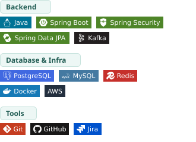

# 최시원　   

 
**인하대학교 정보통신공학과 학사** 2019.03–2025.08  
 
**현대오토에버 모빌리티 SW 스쿨 웹/앱 3기** 2025.12–2026.06  
 
**최종 프로젝트 우수 프로젝트상 1위** 2026.06 
현대오토에버 모빌리티 SW 스쿨 / 현대파츠 ERP  
 

**정보처리기사** 2026.06 
**SQL 개발자(SQLD)** 2025.09

 

## 프로젝트

<table width="100%">
<tr><td>

**HDP ERP**　  

- 가상 자동차 부품 ERP (주문 / 재고 / 구매 / 생산)
- 5인 팀 / User Service, Gateway, 공통 인가 경량 프레임워크 담당
- Keycloak SSO & SCIM 동기화, 웹 세션과 모바일 JWT 인증 정책 분리, Redis 기반 UserSnapshot 권한조회 및 Outbox 캐시 무효화 재처리 구현

</td></tr>
<tr><td>

**ToiletNearby**　

- 주변 화장실 검색 및 후기 서비스
- 3인 팀 / 백엔드 개발
- 좌표 범위 조회와 격자 후보 캐시로 반복 조회를 줄이고, 실제 사용자 좌표로 거리를 다시 계산해 검색 정확성을 유지했습니다.

</td></tr>
<tr><td>

**GameMatch**　

- 온라인 게임 친선경기 매칭 서비스
- 백엔드 리팩토링 담당
- 비관적 락을 통한 동시 승인 정합성 확보, EntityGraph + CTE 적용으로 반복 조회 성능 개선

</td></tr>
</table>

